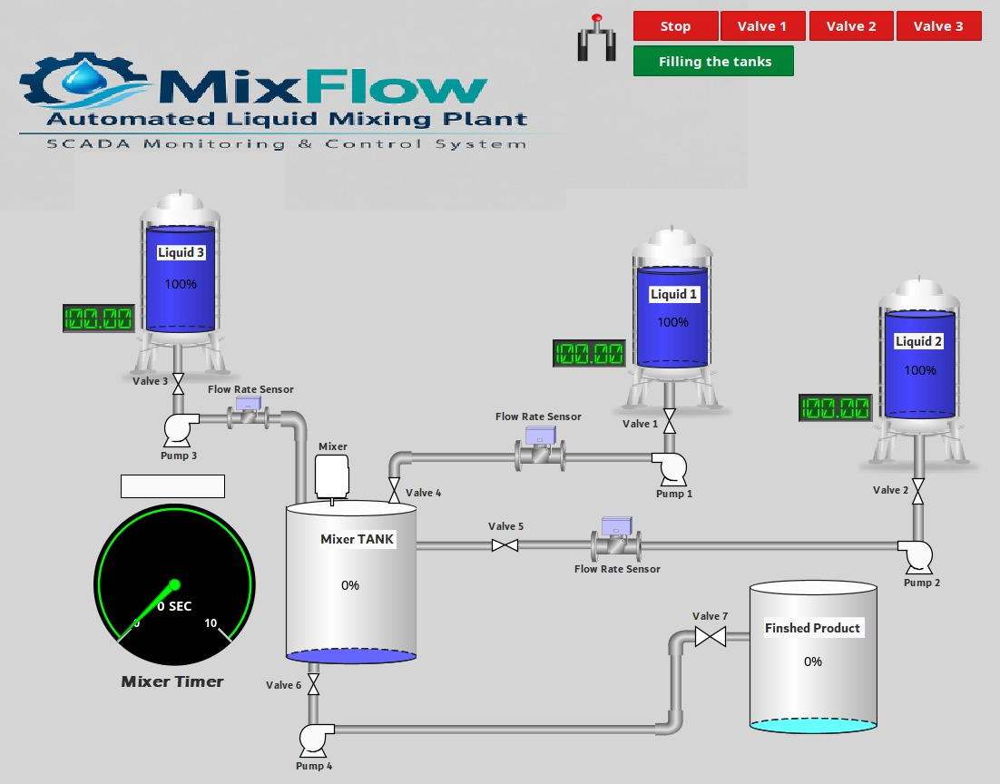
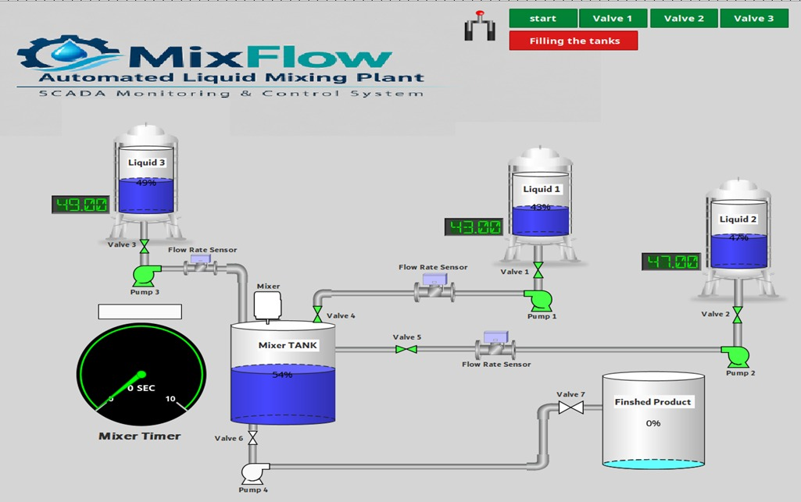
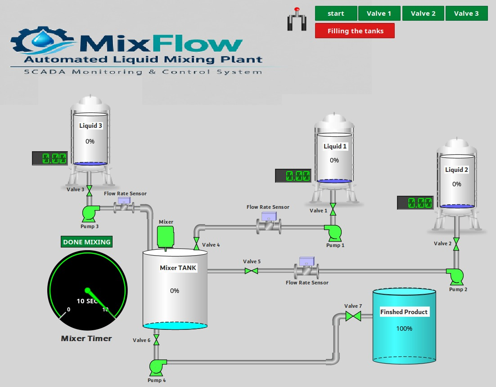

# MixFlow-SCADA

### Automated Liquid Mixing Plant Simulation using Ignition SCADA

MixFlow is a simulated automated liquid mixing plant developed using the **Ignition SCADA platform**. The project demonstrates an industrial process involving liquid filling, mixing, and finished product transfer through a graphical Human-Machine Interface (HMI).

## Project Overview

The system consists of three liquid supply tanks, a mixing tank, and a finished product tank. Each supply tank represents a different liquid and is equipped with simulated pumping and valve control.

The system demonstrates the following process:

1. Transfer liquids from the supply tanks to the mixing tank.
2. Monitor and simulate the liquid levels during filling.
3. Start the mixing process when the filling stage is completed.
4. Transfer the mixed product to the finished product tank.

## System Components

- **3 Supply Tanks:** Store the three different liquids.
- **3 Simulated Pumps:** Represent the liquid transfer pumps.
- **3 Control Valves:** Control the flow from the supply tanks.
- **Mixing Tank:** Receives and mixes the three liquids.
- **Finished Product Tank:** Stores the final mixed product.
- **SCADA HMI:** Provides graphical process monitoring and control.

## Technologies Used

- Ignition SCADA
- Ignition Vision
- Tag Expressions
- Human-Machine Interface (HMI)
- Process Simulation

## Simulation

The project is designed for simulation purposes and does not require physical industrial hardware.

A demonstration GIF and screenshots of the system will be added below.

## Demo

<!-- Add your GIF here -->

## Screenshots
- Before Operation
  

- During Operation

- After Operation

## Project Goals

- Demonstrate a simulated industrial liquid mixing process.
- Implement process monitoring and control using Ignition SCADA.
- Visualize tank levels and process stages through an HMI.
- Develop an understanding of basic automated process operation.

## Author

**AhmedDx**

